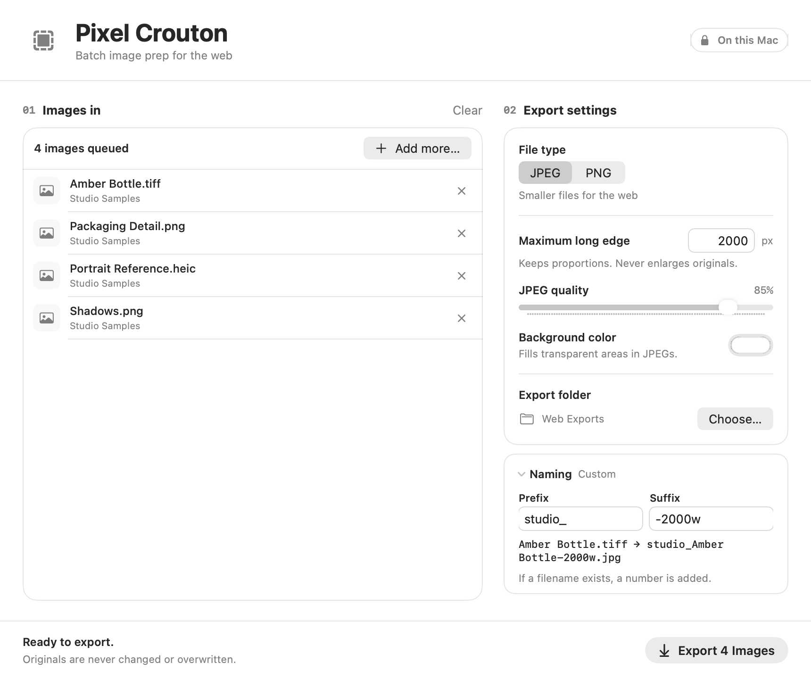

# Pixel Crouton

A little native macOS app for turning a batch of images into web-ready JPEGs or PNGs. Drop in a folder, set the size and format, and export. No account, uploads, telemetry, or dependencies.



## Usage

1. Drag files or folders into **Images in**, or click **Choose Images or Folders…** (⌘O). Folder imports include subfolders and skip hidden files and packages.
2. Pick **JPEG** for smaller files or **PNG** to preserve transparency. JPEG quality starts at 85%, with white behind transparent pixels. You can change both.
3. Set the **Maximum long edge** in pixels (default: 2,000). Images keep their proportions and are never enlarged.
4. Optional: open **Naming** to add a prefix, a suffix, or both. Type any separators you want included. For example, `studio_` and `-1600w` turn `hero.png` into `studio_hero-1600w.jpg` with JPEG selected. The live example shows the name before any collision number.
5. **Choose** an export folder, then **Export**. Click **Show in Finder** to open the result. **View issues** explains failures per file without stopping the rest of the batch.

Changes to export settings and the last export folder are remembered on this Mac. The input queue, prefix, and suffix aren’t saved between launches. If you cancel, the current file finishes and completed exports remain.

### Files and privacy

- Outputs are new files. Pixel Crouton never replaces an original or previous export. Names that collide (including capitalization variants) get `-2`, `-3`, and so on.
- Folder exports are flat, not mirrored. Use a separate destination when repeatedly importing the same source folder so that old exports aren’t picked up as inputs.
- Input decoding uses the macOS Image I/O codecs. Common inputs include JPEG, PNG, HEIC, TIFF, and GIF; format support can vary by macOS version. For animated or multipage inputs, the app writes a single still. WebP isn’t an output format.
- Orientation is applied to the exported pixels. The app does not deliberately copy source metadata such as EXIF or GPS; color profiles can be retained by Image I/O.
- Files are processed one at a time off the UI thread, with no fixed batch-size limit. The maximum long-edge setting accepts 1–12,000 px. Lower it for very large sources if conversion runs out of memory.

## Build from source

Requires macOS 14 or later and an Apple Swift 6 toolchain with a macOS SDK (Xcode or Command Line Tools). No third-party packages are required.

```sh
./scripts/build.sh
open "dist/Pixel Crouton.app"
```

Use `./scripts/build.sh --universal` for one build containing arm64 and x86_64. The output is locally ad hoc signed, not Developer ID signed or notarized. Building from source is the recommended way to try it on another Mac.

```sh
./scripts/test.sh     # synthetic Image I/O and batch regression tests
./scripts/preview.sh  # regenerate the README image with a synthetic queue
```

## License

[MIT](LICENSE)
